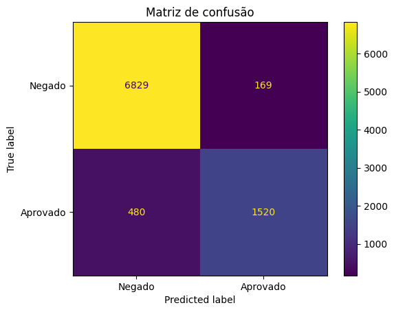
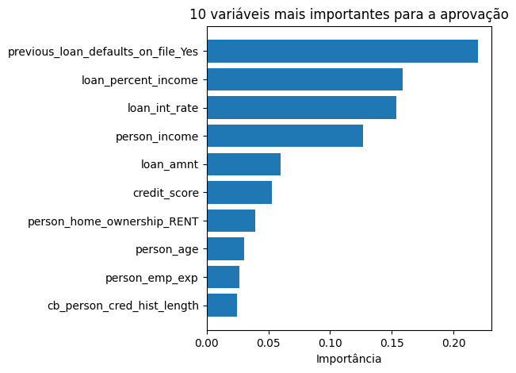
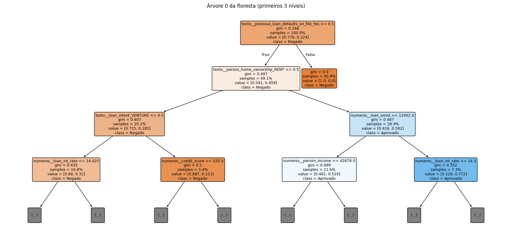

# 💳 PyCredit: Previsão de Aprovação de Empréstimos com Random Forest

Projeto aplicado de Ciência de Dados que utiliza dados públicos do Kaggle para construir um modelo de classificação capaz de prever se uma solicitação de empréstimo será **aprovada** ou **negada**, a partir do perfil do solicitante e das características do empréstimo.

## 👥 Integrantes

| Nome | GitHub |
|------|--------|
| Nome do Integrante 1 | @usuario1 |
| Nome do Integrante 2 | @usuario2 |
| Nome do Integrante 3 | @usuario3 |
| Nome do Integrante 4 | @usuario4 |

---

## 📑 Sumário

1. [Definição do problema](#1-definição-do-problema)
2. [Obtenção dos dados](#2-obtenção-dos-dados)
3. [Preparação e limpeza dos dados](#3-preparação-e-limpeza-dos-dados)
4. [Análise exploratória](#4-análise-exploratória)
5. [Modelagem](#5-modelagem)
6. [Resultados e visualizações](#6-resultados-e-visualizações)
7. [Interpretação dos resultados](#7-interpretação-dos-resultados)
8. [Conclusões, limitações e trabalhos futuros](#8-conclusões-limitações-e-trabalhos-futuros)
9. [Estrutura do repositório](#9-estrutura-do-repositório)
10. [Como executar](#10-como-executar)
11. [Tecnologias utilizadas](#11-tecnologias-utilizadas)
12. [Referências](#12-referências)

---

## 1. Definição do problema

Instituições financeiras precisam decidir, de forma rápida e consistente, se concedem ou não um empréstimo. Uma decisão errada tem custo: aprovar um mau pagador gera inadimplência, e negar um bom pagador significa perder um cliente.

**Pergunta central:** é possível prever a aprovação de um empréstimo a partir de dados demográficos, financeiros e de histórico de crédito do solicitante?

**Tipo de problema:** classificação binária supervisionada.

| Valor de `loan_status` | Significado |
|:---:|---|
| `1` | Empréstimo **aprovado** |
| `0` | Empréstimo **negado** |

**Objetivos específicos:**

- Limpar e validar a base de dados;
- Explorar a distribuição das variáveis;
- Treinar e avaliar um classificador da biblioteca scikit-learn;
- Identificar quais variáveis mais influenciam a decisão;
- Demonstrar o uso do modelo na previsão de novos casos.

---

## 2. Obtenção dos dados

- **Fonte:** Kaggle: [Loan Approval Classification Data](https://www.kaggle.com/datasets/taweilo/loan-approval-classification-data)
- **Formato:** arquivo CSV (`loan_data.csv`)
- **Tamanho original:** 45.000 registros × 14 colunas

### Dicionário de dados

| Coluna | Tipo | Descrição |
|---|---|---|
| `person_age` | numérica | Idade do solicitante (anos) |
| `person_gender` | categórica | Gênero (`male`, `female`) |
| `person_education` | categórica | Escolaridade (`High School`, `Associate`, `Bachelor`, `Master`, `Doctorate`) |
| `person_income` | numérica | Renda anual |
| `person_emp_exp` | numérica | Tempo de experiência profissional (anos) |
| `person_home_ownership` | categórica | Situação de moradia (`RENT`, `MORTGAGE`, `OWN`, `OTHER`) |
| `loan_amnt` | numérica | Valor solicitado |
| `loan_intent` | categórica | Finalidade do empréstimo |
| `loan_int_rate` | numérica | Taxa de juros (%) |
| `loan_percent_income` | numérica | Valor do empréstimo como proporção da renda anual |
| `cb_person_cred_hist_length` | numérica | Tempo de histórico de crédito (anos) |
| `credit_score` | numérica | Pontuação de crédito |
| `previous_loan_defaults_on_file` | categórica | Possui inadimplência anterior registrada (`Yes`, `No`) |
| `loan_status` | **alvo** | 1 = aprovado, 0 = negado |

---

## 3. Preparação e limpeza dos dados

A função `limpar_dados()` executa as verificações e as remoções:

| Verificação | Resultado |
|---|---|
| Valores nulos | 0 |
| Registros duplicados | 0 |
| Idade acima de 100 anos | 7 registros |
| Tempo de serviço acima de 60 anos | 10 registros |
| Registros que atendem aos dois critérios | 7 |
| **Total removido** | **10 registros** |

**Regra de plausibilidade adotada:**

- `IDADE_MAXIMA = 100`
- `TEMPO_SERVICO_MAXIMO = 60`

Os registros removidos tinham valores impossíveis, como idade de 144 anos com 125 anos de experiência profissional. Esses valores indicam erro de digitação ou de geração dos dados e poderiam distorcer o modelo.

| Etapa | Registros |
|---|---|
| Antes da limpeza | 45.000 |
| Removidos | 10 |
| **Após a limpeza** | **44.990** |

Após a limpeza, os maiores valores passaram a ser **78 anos** de idade e **58 anos** de experiência profissional, ambos plausíveis.

> **Decisão técnica:** optou-se por **remover** os registros em vez de **corrigi-los**. Eles representam apenas 0,02% da base e não há como inferir o valor correto.

---

## 4. Análise exploratória

### 4.1 Variáveis categóricas

**Gênero**

| Rótulo | Registros |
|---|---|
| male | 24.833 |
| female | 20.157 |

**Escolaridade**

| Rótulo | Registros |
|---|---|
| Bachelor | 13.396 |
| Associate | 12.026 |
| High School | 11.967 |
| Master | 6.980 |
| Doctorate | 621 |

**Situação de moradia**

| Rótulo | Registros |
|---|---|
| RENT | 23.438 |
| MORTGAGE | 18.484 |
| OWN | 2.951 |
| OTHER | 117 |

**Finalidade do empréstimo**

| Rótulo | Registros |
|---|---|
| EDUCATION | 9.151 |
| MEDICAL | 8.546 |
| VENTURE | 7.815 |
| PERSONAL | 7.550 |
| DEBTCONSOLIDATION | 7.145 |
| HOMEIMPROVEMENT | 4.783 |

### 4.2 Distribuição da variável alvo

Apenas **22,2%** dos empréstimos da base foram aprovados. A base é **desbalanceada**, com aproximadamente 3,5 empréstimos negados para cada aprovado. Esse desbalanceamento motivou duas decisões:

- uso de **amostragem estratificada** na divisão entre treino e teste;
- uso do **F1-score** como métrica principal, em vez de apenas a acurácia.

### 4.3 Observações

- As finalidades de empréstimo são relativamente equilibradas, com exceção de `HOMEIMPROVEMENT`, que tem menos registros.
- A categoria `OTHER` de moradia e o nível `Doctorate` têm poucos registros, o que limita o que o modelo consegue aprender sobre esses grupos.
- Faixas após a limpeza: idade de 20 a 78 anos; `credit_score` de 390 a 784; `loan_percent_income` de 0 a 0,66.

---

## 5. Modelagem

### 5.1 Algoritmo escolhido: Random Forest (`RandomForestClassifier`)

**Justificativa:**

- Lida bem com relações não lineares entre as variáveis;
- Não exige normalização das variáveis numéricas;
- É robusto a outliers e reduz o sobreajuste ao combinar o voto de várias árvores;
- Fornece a **importância das variáveis**, o que facilita a interpretação do modelo.

### 5.2 Divisão entre treino e teste

| Conjunto | Registros | Proporção de aprovados |
|---|---|---|
| Treino (80%) | 35.992 | 0,222 |
| Teste (20%) | 8.998 | 0,222 |

O parâmetro `stratify=y` mantém a mesma proporção de aprovados nos dois conjuntos. O parâmetro `random_state=42` torna o resultado reproduzível.

### 5.3 Pipeline

```
Pipeline
├── preprocessamento (ColumnTransformer)
│   ├── texto   → OneHotEncoder(drop="if_binary")   # variáveis categóricas
│   └── numeros → passthrough                        # variáveis numéricas
└── rf → RandomForestClassifier(n_estimators=200, random_state=42, n_jobs=-1)
```

**Por que usar `Pipeline`:** durante a validação cruzada, o pré-processamento é ajustado apenas com os dados de treino de cada etapa. Isso evita vazamento de dados (*data leakage*). Além disso, os novos dados passam exatamente pelas mesmas transformações usadas no treino.

**Por que usar `drop="if_binary"`:** variáveis com apenas dois valores (`person_gender` e `previous_loan_defaults_on_file`) viram uma única coluna 0/1, sem gerar informação redundante.

### 5.4 Avaliação

- **Validação cruzada** com 5 partições (`cv=5`) nos dados de treino, usando o F1-score;
- **Avaliação final** no conjunto de teste, que não participou do treinamento.

---

## 6. Resultados e visualizações

### 6.1 Validação cruzada

| Métrica | Valor |
|---|---|
| F1 médio (5 partições, dados de treino) | **0,8261** |

### 6.2 Relatório de classificação (conjunto de teste)

| Classe | Precisão | Recall | F1-score | Suporte |
|---|---|---|---|---|
| Negado | 0,93 | 0,98 | 0,95 | 6.998 |
| Aprovado | 0,90 | 0,76 | 0,82 | 2.000 |
| **Acurácia** | | | **0,93** | 8.998 |
| Média macro | 0,92 | 0,87 | 0,89 | 8.998 |
| Média ponderada | 0,93 | 0,93 | 0,93 | 8.998 |

O F1 da classe "Aprovado" no teste (0,82) está muito próximo do valor obtido na validação cruzada (0,826). Isso indica que o modelo **generaliza bem** para dados novos e não está sobreajustado.

### 6.3 Matriz de confusão



A matriz mostra os acertos e erros do modelo no conjunto de teste para cada classe. A diagonal principal concentra a grande maioria das previsões, o que confirma os valores do relatório de classificação.

### 6.4 Importância das variáveis



O gráfico mostra as 10 variáveis com maior peso nas decisões do modelo. A importância é calculada pela redução média de impureza que cada variável provoca nas divisões das 200 árvores da floresta.

### 6.5 Visualização de uma árvore da floresta



A figura mostra os 3 primeiros níveis da árvore de índice 0. É possível observar quais variáveis e quais limites a árvore usa nas primeiras divisões. O modelo final combina o voto de 200 árvores como esta.

### 6.6 Demonstração: previsão de novos solicitantes

| Perfil | Renda | Valor solicitado | % da renda | Score | Inadimplência anterior | Resultado | Prob. de aprovação |
|---|---|---|---|---|---|---|---|
| Pessoa 1 | 51.609 | 6.665 | 13% | 628 | Não | ✅ APROVADO | 95,5% |
| Pessoa 2 | 20.000 | 15.000 | 75% | 520 | Sim | ❌ NEGADO | 26,0% |

A função `prever_pessoa()` recebe um dicionário com os dados do solicitante e retorna a classe prevista e a probabilidade de aprovação.

---

## 7. Interpretação dos resultados

- **Acurácia de 93%:** o modelo acerta a grande maioria das decisões. Como a base é desbalanceada, porém, a acurácia sozinha não é suficiente. Um modelo que simplesmente negasse todos os pedidos já teria cerca de 78% de acurácia.
- **Classe "Negado" (F1 = 0,95):** o modelo identifica muito bem quem deve ser negado. Apenas cerca de 2% dos negados reais foram aprovados por engano.
- **Classe "Aprovado" (precisão = 0,90 e recall = 0,76):**
  - Quando o modelo prevê "aprovado", ele acerta em 90% dos casos;
  - Porém, cerca de **24% dos aprovados reais** são classificados como negados.
- **Comportamento conservador:** o modelo erra mais negando bons clientes do que aprovando maus clientes. Do ponto de vista de risco de crédito, esse comportamento é preferível, porque aprovar um inadimplente costuma custar mais do que perder um cliente.
- **Previsões de exemplo:** os resultados são coerentes com a lógica de negócio. A Pessoa 2 pede 75% da renda anual, tem score baixo e já foi inadimplente, e por isso recebeu baixa probabilidade de aprovação.

---

## 8. Conclusões, limitações e trabalhos futuros

### Conclusões

O Random Forest mostrou-se adequado ao problema. O modelo obteve F1 de 0,82 na classe minoritária e acurácia de 93%, com desempenho consistente entre a validação cruzada e o conjunto de teste. O uso de `Pipeline` tornou a solução organizada, reproduzível e pronta para prever novos casos.

### Limitações

- **Desbalanceamento:** o recall de 0,76 na classe "Aprovado" mostra que o modelo ainda deixa de identificar parte dos bons clientes.
- **Variáveis sensíveis:** o modelo usa `person_gender`. Em um cenário real de concessão de crédito, isso exigiria análise de viés e verificação de conformidade com a legislação antidiscriminação.
- **Exemplos de demonstração:**
  - O perfil da Pessoa 1 é idêntico ao último registro da base (índice 44.999). Ele pode ter sido usado no treino, o que tende a elevar a confiança da previsão.
  - A Pessoa 2 tem `loan_percent_income = 0,75`, valor acima do máximo observado na base (0,66). Nesse caso, o modelo está extrapolando para fora dos dados que conhece.
- **Hiperparâmetros:** foram usados valores fixos, sem busca sistemática pelos melhores valores.

### Trabalhos futuros

- Testar `class_weight="balanced"` ou ajustar o limiar de decisão para aumentar o recall dos aprovados;
- Otimizar os hiperparâmetros com `GridSearchCV` ou `RandomizedSearchCV`;
- Comparar o desempenho com outros algoritmos, como Regressão Logística e Gradient Boosting;
- Avaliar o modelo com e sem a variável `person_gender`;
- Usar a curva ROC/AUC e a curva Precisão-Recall como métricas complementares.

---

## 9. Estrutura do repositório

```
├── PyCredit.ipynb          # Notebook com todo o projeto
├── README.md               # Documentação do projeto
├── requirements.txt        # Dependências
├── imagens/                # Gráficos gerados pelo notebook
│   ├── matriz_confusao.png
│   ├── importancia_variaveis.png
│   └── arvore_0.png
└── docs/
    ├── relatorio_tecnico.pdf
    └── apresentacao.pdf
```

> O arquivo `loan_data.csv` não está incluído no repositório. Ele deve ser baixado diretamente do Kaggle (link na seção 2).

---

## 10. Como executar

### Opção 1: Google Colab (recomendado)

1. Abra o arquivo `PyCredit.ipynb` no [Google Colab](https://colab.research.google.com/);
2. Baixe o arquivo `loan_data.csv` no [Kaggle](https://www.kaggle.com/datasets/taweilo/loan-approval-classification-data);
3. Execute as células em ordem. A segunda célula exibe um botão para enviar o CSV.

### Opção 2: Execução local

1. Clone este repositório e entre na pasta do projeto;
2. Coloque o arquivo `loan_data.csv` na mesma pasta do notebook;
3. Instale as dependências e abra o notebook:

```bash
pip install -r requirements.txt
jupyter notebook PyCredit.ipynb
```

Na execução local, substitua a célula de upload do Colab por:

```python
import pandas as pd
dados = pd.read_csv("loan_data.csv")
```

---

## 11. Tecnologias utilizadas

| Biblioteca | Uso no projeto |
|---|---|
| **pandas** | Leitura do CSV, limpeza, contagens e manipulação dos dados |
| **scikit-learn** | `train_test_split`, `cross_val_score`, `OneHotEncoder`, `ColumnTransformer`, `Pipeline`, `RandomForestClassifier`, `classification_report`, `ConfusionMatrixDisplay` e `plot_tree` |
| **matplotlib** | Matriz de confusão, gráfico de importância das variáveis e visualização da árvore |
| **Google Colab** | Ambiente de execução do notebook |

---

## 12. Referências

- Dataset: [Loan Approval Classification Data (Kaggle)](https://www.kaggle.com/datasets/taweilo/loan-approval-classification-data)
- Documentação do scikit-learn: [RandomForestClassifier](https://scikit-learn.org/stable/modules/generated/sklearn.ensemble.RandomForestClassifier.html)
- Documentação do scikit-learn: [Pipeline e ColumnTransformer](https://scikit-learn.org/stable/modules/compose.html)
